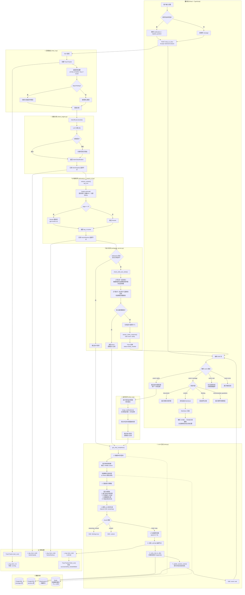

# RAG 问答链路流程图

## 关键数据流

| 阶段 | 输入 | 输出 | 文件 |
|------|------|------|------|
| 意图分类 | 用户问题 | IntentCode + Score | `intent_engine.py` |
| 向量检索 | 用户问题 + top_k | 最多 6 条 chunk | `retrieval.py` → `search_v2.py` |
| 歧义检测 | 问题 + 检索结果 | 追问列表 或 None | `ambiguity_service.py` |
| 提示词渲染 | 模板 + 问题 + 参考内容 | 完整 prompt | `chat.py:render_prompt_template()` |
| LLM 生成 | prompt (流式) | SSE 事件流 | `chat.py:get_chat_completion()` |
| 前端渲染 | SSE 流 | Markdown + 引用徽章 | `result.tsx` |

## 引用格式约定

- **后端拼接**: `##N$$ content` (chat.py:319)
- **前端解析**: 正则 `/^##(\d+?)\$\$/` (result.tsx:53)
- **渲染**: `[N+1]`

## 歧义检测模式

| 旧模式 | 新模式 (信息审计) |
|--------|------------------|
| 先生成草稿回答 | 先列出必需参数 |
| 后自查假设 | 对比用户已提供信息 |
| LLM 已投入立场 | LLM 是中立的审计员 |
| 规则: "如果回答不准确则追问" | 规则: "任何缺失参数都追问" |
